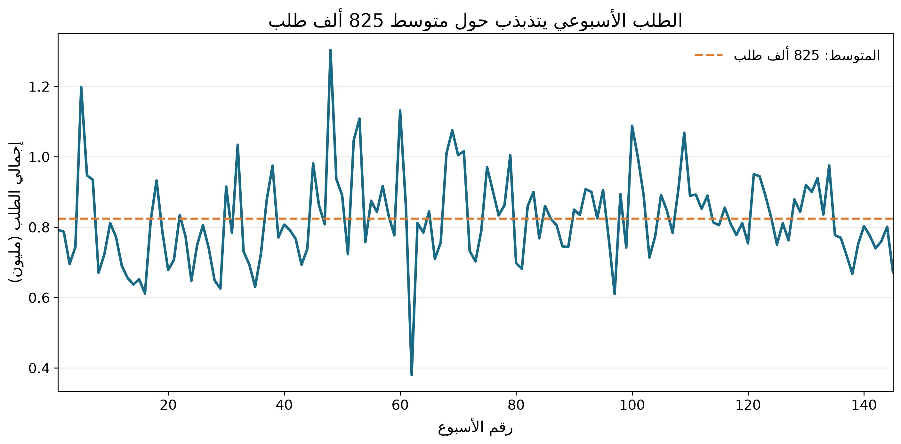
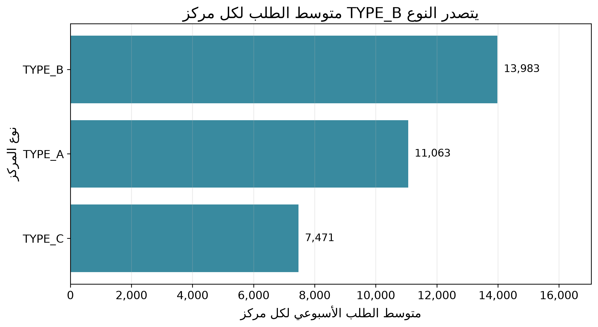
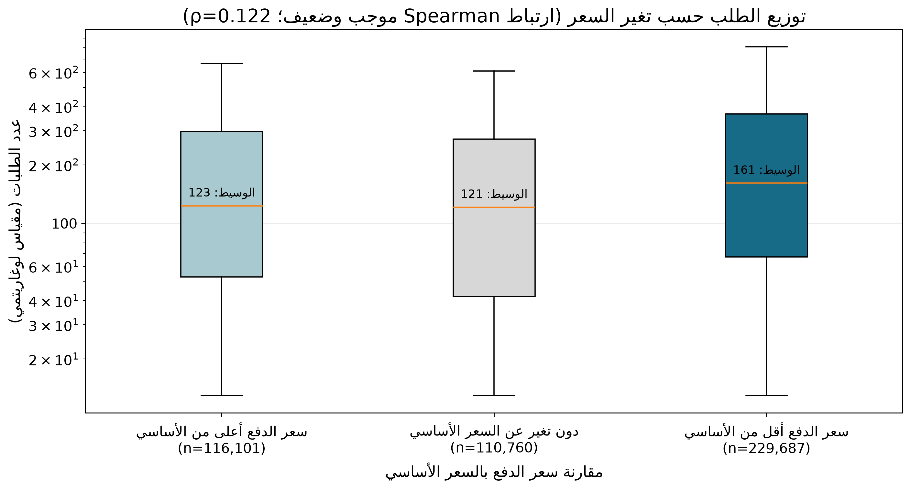
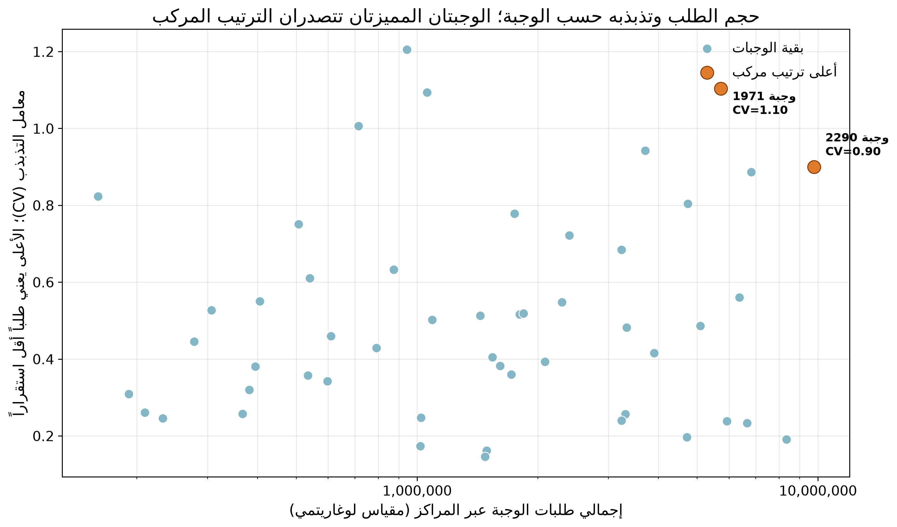

# تقرير أداء طلبات الوجبات

## الملخص التنفيذي

- **أهم نتيجة:** سجّلت البيانات 119,557,485 طلباً عبر 145 أسبوعاً؛ وهذا يحدد حجم الطلب التاريخي الذي ينبغي أن يبدأ منه تخطيط العمليات. **المصدر:** دفتر التحليل، قسم «مؤشرات الطلب والتذبذب»، خلية الكود 4.
- بلغ متوسط إجمالي الطلب الأسبوعي 824,534.38 طلباً، مع تفاوت ملحوظ بين الأسابيع. **المصدر:** القسم نفسه، خلية الكود 4؛ [رسم الطلب الأسبوعي](figures/weekly_demand.png).
- استحوذت أول 5 فئات على 81.40% من الطلب، وغطت أول 22 وجبة 81.18%. **المصدر:** القسم نفسه، خلية الكود 4؛ [رسم الطلب حسب الفئة](figures/category_demand.png).
- تصدّر النوع `TYPE_B` متوسط الطلب الأسبوعي لكل مركز، بمتوسط 13,982.63 مقارنةً بـ11,063.11 للنوع `TYPE_A` و7,471.11 للنوع `TYPE_C`. **المصدر:** القسم نفسه، خلية الكود 4؛ [رسم مقارنة أنواع المراكز](figures/center_type_demand.png).
- ارتبط الخصم بالطلبات ارتباطاً موجباً ضعيفاً (`Spearman rho = 0.1218`)؛ النتيجة ارتباطية ولا تثبت السببية. **المصدر:** قسم «الاختبارات الإحصائية»، خلية الكود 5؛ [رسم الخصم والطلبات](figures/discount_vs_orders.png).

## إجابات أسئلة العمل والرسوم

### السؤال 1: كيف يتغير الطلب الأسبوعي؟

بلغ متوسط إجمالي الطلب الأسبوعي 824,534.38 طلباً. يعرض الرسم مجموع الطلبات لكل أسبوع مسجل، ويوضح التفاوت بين الأسابيع من دون تفسيره بسبب تشغيلي محدد.

**طريقة القراءة:** الخط البرتقالي المتقطع يوضح متوسط الطلب الأسبوعي؛ المحور الرأسي معروض بالملايين لتسهيل مقارنة الأسابيع.

**المصدر:** دفتر التحليل، قسم «مؤشرات الطلب والتذبذب»، خلية الكود 4؛ الرسم في خلية الكود 6.

### السؤال 2: ما الفئات والوجبات التي تمثل نحو 80% من الطلب؟

تصدرت فئة المشروبات بإجمالي 40,480,525 طلباً. تجاوزت أول خمس فئات معاً عتبة 80% ووصلت إلى 81.40%. وعلى مستوى الوجبات، أسهمت أول 21 وجبة في 79.72%، ووصلت حصة أول 22 وجبة إلى 81.18%.

**طريقة القراءة:** الفئات مرتبة من الأقل إلى الأعلى، والرقم بجوار كل شريط يوضح إجمالي الطلب وحصته من الإجمالي. الأسماء معروضة بالعربية.

**المصدر:** جدولا `category_demand` و`top_80_meals` في قسم «مؤشرات الطلب والتذبذب»، خلية الكود 4؛ الرسم في خلية الكود 6.

### السؤال 3: كيف تختلف مؤشرات الطلب بين أنواع المراكز؟

بلغ متوسط الطلب الأسبوعي لكل مركز 13,982.63 في `TYPE_B`، و11,063.11 في `TYPE_A`، و7,471.11 في `TYPE_C`. هذه مقارنة وصفية؛ وقد تتداخل معها اختلافات المراكز في الحجم أو التشغيل.

**طريقة القراءة:** يعرض كل شريط متوسط الطلب الأسبوعي لكل مركز من النوع المقابل، وتظهر القيمة مباشرة عند نهاية الشريط.

**المصدر:** جدول `center_type_demand` في قسم «مؤشرات الطلب والتذبذب»، خلية الكود 4؛ الرسم في خلية الكود 6.

### السؤال 4: كيف تختلف الطلبات مع الترويج وبدونه؟

قورنت الوجبة نفسها داخل المركز نفسه باختبار Mann–Whitney، واشترط الاختبار وجود مشاهدتين على الأقل في كل حالة. بلغ وسيط التغير النسبي بين وسيطي الطلب داخل المجموعات المؤهلة 151.86% للبريد الترويجي و134.68% للظهور في الصفحة الرئيسية. بعد تصحيح Benjamini–Hochberg، كانت `q < 0.05` في 2,345 من 2,814 مجموعة للبريد، وفي 2,317 من 2,798 مجموعة للظهور في الصفحة.

هذه النسب تلخص الفروق الوصفية بين الوسيطين؛ اختبار Mann–Whitney يقارن التوزيعات ولا يقدّر تلك النسب مباشرةً. كذلك، تزامن البريد الترويجي مع سعر أقل من السعر الأساسي في 96.82% من صفوفه، مقابل 46.20% من صفوف البريد غير الترويجي؛ لذلك لا تعزل المقارنة ارتباط الترويج عن الخصم أو عوامل أخرى.

**طريقة القراءة:** الخط البرتقالي داخل كل صندوق هو وسيط الطلب، والصندوق يبين النصف الأوسط من القيم؛ يوضح أسفل كل مجموعة عدد السجلات. لا تظهر النقاط المتطرفة لتقليل ازدحام الرسم.

يعرض الرسم الثاني المقارنة نفسها للظهور في الصفحة الرئيسية. ارتفاع الوسيط وصفياً لا يثبت أن الترويج هو سبب الفرق.

**المصدر:** جدولا `promotion_summary` و`discount_promotion_context` في قسم «الاختبارات الإحصائية»، خلية الكود 5؛ الرسمان في خلية الكود 6.

### السؤال 5: ما علاقة الخصم بالطلبات؟

بلغ متوسط فرق السعر النسبي المحسوب بالصيغة `(base_price - checkout_price) / base_price` مقدار 5.72% عبر 456,548 صفاً ذات سعر أساسي موجب. وكان ارتباط Spearman بين فرق السعر النسبي والطلبات موجباً وضعيفاً (`rho = 0.1218`، `n = 456,548`). لا يضبط هذا الارتباط المركز أو الوجبة أو الأسبوع أو تزامن العروض، ولا يثبت علاقة سببية.

**طريقة القراءة:** يقسم الرسم السجلات إلى ثلاث حالات واضحة: سعر الدفع أعلى من السعر الأساسي، أو مساوٍ له، أو أقل منه. الخط داخل الصندوق هو الوسيط والصندوق يمثل النصف الأوسط من الطلبات؛ أُخفيت القيم المتطرفة لتسهيل المقارنة، والمحور الرأسي لوغاريتمي بسبب تفاوت أحجام الطلب. أعداد السجلات ظاهرة أسفل كل فئة. هذا عرض وصفي، ولا يعني أن تغير السعر أدى إلى اختلاف الطلب.

**المصدر:** قسم «مؤشرات الطلب والتذبذب»، خلية الكود 4؛ ونتيجة Spearman في قسم «الاختبارات الإحصائية»، خلية الكود 5؛ الرسم في خلية الكود 6.

### السؤال 6: ما الوجبات التي تجمع حجم الطلب والتذبذب؟

جاءت الوجبة `2290` أولاً في الترتيب المركب، بدرجة 0.951، وبلغ مجموع طلباتها 9,770,303 ومعامل التذبذب `CV = 0.900`. تلتها الوجبة `1971` بدرجة 0.931، ومجموع طلبات 5,728,620 و`CV = 1.104`. الدرجة متوسط رتبة مئوية للحجم والتذبذب، وتفيد في ترتيب المراجعة لا في تحديد كمية مخزون نهائية.

**طريقة القراءة:** كل نقطة تمثل وجبة واحدة، وإجمالي طلبها محسوب عبر المراكز؛ المحور الأفقي لوغاريتمي لتفاوت أحجام الطلب. أُبرزت الوجبتان الأعلى في الترتيب المركب مع قيمة معامل التذبذب لكل منهما. حُسب التذبذب من الأسابيع المرصودة فقط، ولا يمثل مخزوناً مقترحاً أو طلباً متوقعاً.

**المصدر:** جدول `joint_demand_ranking` في قسم «مؤشرات الطلب والتذبذب»، خلية الكود 4؛ الرسم في خلية الكود 6.

## مؤشرات إضافية

قدّر التحليل إجمالي الإيراد بـ31,922,771,040.11 بوحدات السعر الموجودة في البيانات، وفق `checkout_price × num_orders`. هذا تقدير للإيراد وليس للربح، ولا يشمل التكاليف أو الهدر أو الضرائب.

**المصدر:** قسم «مؤشرات الطلب والتذبذب»، خلية الكود 4.

## التوصيات

1. **القرار المقترح:** ابدأ التوقع الأسبوعي ومراجعة التوفر بأعلى 22 وجبة، ثم وزّع الخطة حسب المركز قبل اعتماد الشراء. **الرقم الداعم:** تمثل هذه الوجبات 81.18% من الطلب المسجل. **مؤشر النجاح:** خطأ التوقع الأسبوعي (WAPE) لكل وجبة ومركز، مع متابعة معدل نفاد الوجبات والهدر. **المصدر:** جدول `top_80_meals`، خلية الكود 4.
2. **القرار المقترح:** راجع الوجبتين `2290` و`1971` حسب المركز قبل تعديل مخزون الأمان، وسجّل بيانات المخزون الفعلي والهدر والنفاد. **الأرقام الداعمة:** للوجبة `2290` عدد 9,770,303 طلبات و`CV = 0.900`؛ وللوجبة `1971` عدد 5,728,620 و`CV = 1.104`. **مؤشر النجاح:** انخفاض معدل النفاد والهدر لكل وجبة ومركز مقارنةً بخط الأساس. **المصدر:** جدول `joint_demand_ranking`، خلية الكود 4.
3. **القرار المقترح:** نفّذ تجربة ترويج مضبوطة مع مجموعة مقارنة قبل تغيير الميزانية، وسجّل الخصم والتوقيت والطلب والإيراد والهامش لكل مجموعة. **الرقم الداعم:** كان سعر الدفع دون السعر الأساسي في 96.82% من صفوف البريد الترويجي مقابل 46.20% من صفوف البريد غير الترويجي. **مؤشر النجاح:** الزيادة الصافية في الطلب والهامش مقارنةً بالمجموعة الضابطة، مع متابعة الهدر. لا تُستخدم المقارنة الرصدية الحالية كتقدير لأثر الترويج. **المصدر:** جدول `discount_promotion_context`، خلية الكود 5.

## حدود التحليل

- البيانات رصدية، والاختبارات والارتباطات لا تثبت السببية.
- حقل `week` رقم أسبوع لا تاريخ تقويمياً؛ لا تتوفر تواريخ فعلية لمطابقة الموسمية أو الأحداث.
- لا يظهر اسم المدينة في الملفات التحليلية؛ المراكز ممثلة بمعرّفات مثل `center_id`، ما يحد من تفسير الفروق جغرافياً.
- تتكرر مشاهدات الوجبات والمراكز عبر الزمن. تصحيح تعدد اختبارات Mann–Whitney لا يضمن استقلال المشاهدات أو يزيل كل عوامل الالتباس.
- يتزامن الترويج غالباً مع انخفاض السعر عن السعر الأساسي، كما أن ارتباط Spearman لا يضبط المركز أو الوجبة أو الأسبوع أو الترويج.
- بعض أسابيع سلاسل المركز-الوجبة غير مسجلة. لم تُملأ هذه الفجوات بأصفار لأن غياب الصف لا يثبت انعدام الطلب.
- أُبقيت القيم المتطرفة وفق قاعدة IQR والصفوف التي يتجاوز فيها سعر الدفع السعر الأساسي؛ فهذه الفحوص وحدها لا تثبت وجود خطأ.
- لا تتضمن البيانات المخزون الفعلي أو التلف أو نفاد المخزون أو التكاليف، لذلك لا يمكن قياس الهدر الفعلي أو تحديد مخزون أمان أمثل.
- تقدير الإيراد لا يمثل صافي الربح، ولا تحدد الملفات وحدة العملة.

## المواد الداعمة

- [دفتر التحليل](../notebooks/analysis.ipynb)
- [قرارات فحص البيانات والتنظيف](../docs/cleaning_decisions.md)
- [README المشروع](../README.md)
- [مجلد الرسوم](figures/)
