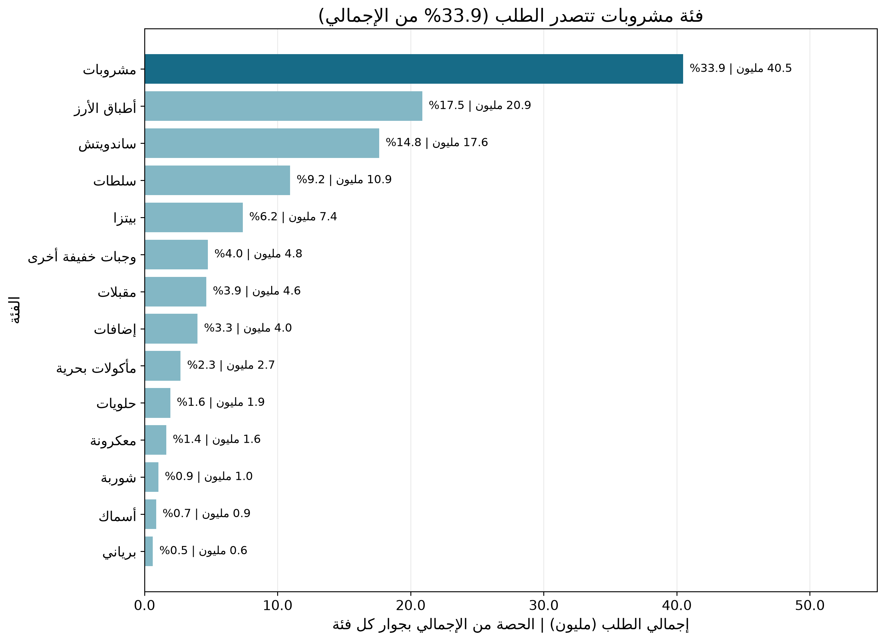
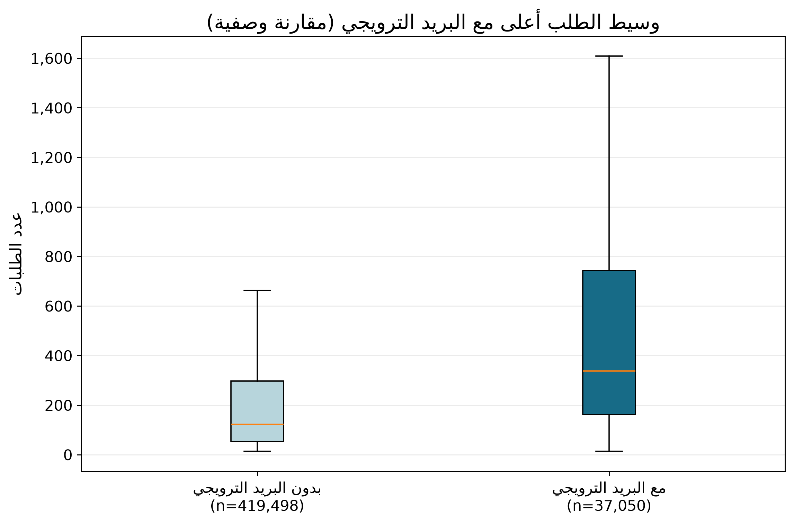
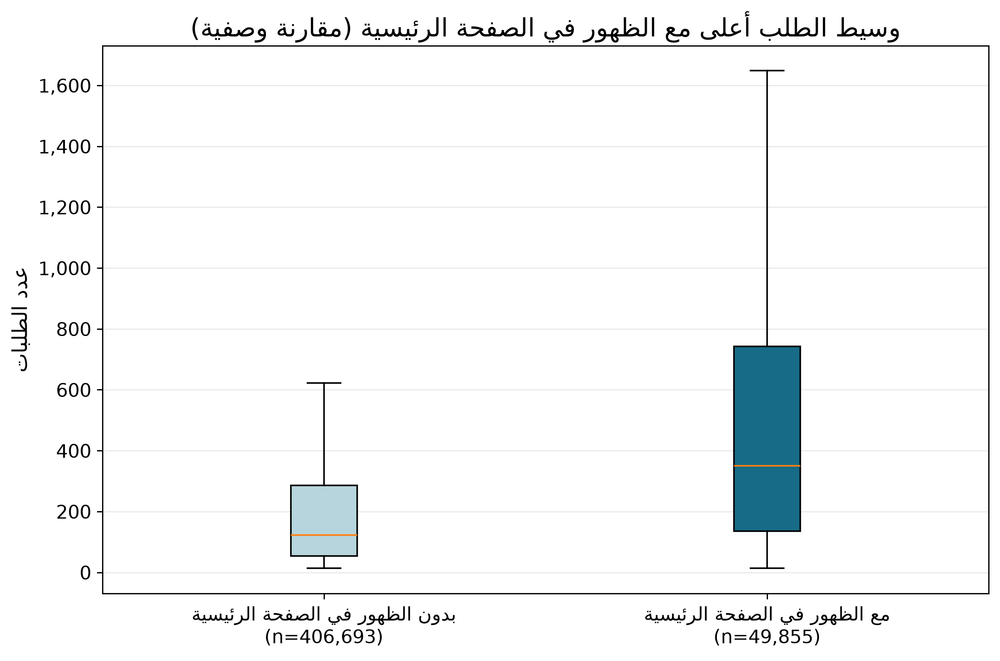

# عرض موجز: أداء طلبات الوجبات

> **الغرض:** تحويل سجلات الطلب الأسبوعية إلى مؤشرات عملية تساعد فريق العمليات على ترتيب أولويات التخطيط، مع توضيح ما تدعمه البيانات وما لا يمكن استنتاجه منها. كل رقم في العرض موثق بخلية إنتاجه في [دفتر التحليل](../notebooks/analysis.ipynb). أُعيد إعداد الرسوم بدقة أعلى، مع وحدات واضحة وتسميات عربية وشروحات مختصرة لطريقة القراءة.

## الشريحة 1: المشكلة والهدف

- يحتاج فريق العمليات إلى تخطيط كميات الوجبات بما يوازن بين تلبية الطلب والحد من الهدر والنفاد.
- يحلل المشروع الطلب المسجل بحسب الأسبوع والوجبة ومركز التجهيز، ويراجع الفئات والمراكز والترويج والأسعار وتذبذب الطلب.
- الهدف هو تحديد نقاط بدء عملية للتخطيط وتجارب قابلة للقياس، لا ادعاء علاقة سببية من بيانات رصدية.
- **مصدر سياق البيانات والمنهج:** مقدمة الدفتر وخلية الكود 1؛ [سجل قرارات التنظيف](../docs/cleaning_decisions.md).

## الشريحة 2: البيانات وفحوص الجودة

- يجمع التحليل `train.csv` (456,548 صفاً، و9 أعمدة) مع جدول مراكز التجهيز (77 صفاً) وجدول الوجبات (51 صفاً). يحتوي `train.csv` على 119,557,485 طلباً مسجلاً. **المصدر:** دفتر التحليل، خلية الكود 1.
- رُبطت بيانات المركز على `center_id` وبيانات الوجبة على `meal_id`؛ بقي عدد صفوف الطلبات ومجموعها دون تغيير بعد الربط، ولم توجد مفاتيح وصفية مكررة أو سجلات طلب غير مطابقة. **المصدر:** خلية الكود 2.
- لم تُرصد قيم مفقودة أو مفاتيح عمل مكررة؛ ورُصدت 116,101 حالة يكون فيها سعر الدفع أعلى من السعر الأساسي، و32,937 صف طلب معلماً كقيمة متطرفة وفق قاعدة IQR. **المصدر:** خلية الكود 3.
- غابت 65,017 خانة أسبوعية عن التغطية الكاملة لسلاسل المركز-الوجبة، ولم تُملأ بأصفار؛ كما لم تُحذف الحالات السعرية أو المتطرفة تلقائياً لعدم كفاية الدليل على أنها أخطاء. **المصدر:** خلية الكود 3؛ [قرارات الجودة والتنظيف](../docs/cleaning_decisions.md).

## الشريحة 3: النتيجة الأبرز — الطلب متركز في عدد محدود من الأصناف

- استحوذت أول 5 فئات على 81.40% من الطلب المسجل، وتصدرت فئة المشروبات بإجمالي 40,480,525 طلباً.
- تمثل أول 22 وجبة 81.18% من الطلب، وفق ترتيب إجمالي الطلب.
- **الدلالة التشغيلية:** ابدأ التوقع ومراجعة التوفر بهذه المجموعة، ثم افحص الحاجة حسب المركز؛ لا تعتمد شراءً نهائياً على النسبة الإجمالية وحدها.
- **المصدر:** جدولا `top_80_categories` و`top_80_meals` في قسم «مؤشرات الطلب والتذبذب»، خلية الكود 4.

*الأشرطة مرتبة حسب حجم الطلب؛ القيمة بجوار كل فئة تعرض إجمالي الطلب وحصتها من الإجمالي.*

## الشريحة 4: النتيجة الثانية — الترويج يترافق مع فروق طلب رصدية لا تثبت أثره

- داخل مجموعات المركز والوجبة المؤهلة للمقارنة، بلغ وسيط التغير النسبي بين وسيطي الطلب 151.86% للبريد الترويجي و134.68% للظهور في الصفحة الرئيسية.
- استخدم التحليل اختبار Mann–Whitney ثنائي الطرف عند توافر مشاهدتين على الأقل لكل حالة، ثم صحح قيم الاختبارات المتعددة بطريقة Benjamini–Hochberg؛ بلغت المجموعات ذات `q < 0.05` مقدار 2,345 من 2,814 للبريد و2,317 من 2,798 للظهور.
- تزامن البريد الترويجي مع سعر دفع أقل من السعر الأساسي في 96.82% من صفوفه، مقابل 46.20% دون البريد؛ لذلك لا تفصل هذه المقارنة ارتباط الترويج عن الخصم أو عوامل أخرى.
- **الاستنتاج:** النتائج ارتباطية ورصدية، ولا تبرر تقدير أثر سببي مستقل للترويج.
- **المصدر:** جدولا `promotion_summary` و`discount_promotion_context` في قسم «الاختبارات الإحصائية»، خلية الكود 5.

*الخط داخل الصندوق هو الوسيط، ويظهر حجم العينة أسفل كل مجموعة؛ المقارنة وصفية وليست دليلاً سببياً.*

*ألوان الرسمين تميز مجموعتي المقارنة، مع إخفاء النقاط المتطرفة لتقليل ازدحام الصورة.*

## الشريحة 5: توصيات قابلة للمتابعة

1. **ابدأ التخطيط بأعلى الوجبات طلباً، ثم وزّع التقدير حسب المركز.** الدليل: أول 22 وجبة تمثل 81.18% من الطلب. **مؤشرات المتابعة:** WAPE لكل وجبة ومركز، ومعدل نفاد الوجبات والهدر. **المصدر:** جدول `top_80_meals`، خلية الكود 4.
2. **راجع الوجبات التي تجمع الحجم والتذبذب قبل تعديل مخزون الأمان.** الدليل: الوجبة `2290` سجلت 9,770,303 طلبات ومعامل تذبذب `CV = 0.900`، والوجبة `1971` سجلت 5,728,620 طلباً و`CV = 1.104`. **مؤشرات المتابعة:** معدل النفاد والهدر لكل وجبة ومركز مقابل خط أساس. **المصدر:** جدول `joint_demand_ranking`، خلية الكود 4.
3. **اختبر الترويج بتجربة مضبوطة قبل تغيير الميزانية.** الدليل: انخفض سعر الدفع عن السعر الأساسي في 96.82% من صفوف البريد الترويجي مقابل 46.20% من صفوف البريد غير الترويجي. **مؤشرات المتابعة:** فرق الطلب والهامش مقابل مجموعة مقارنة، مع تسجيل الخصم والهدر. **المصدر:** جدول `discount_promotion_context`، خلية الكود 5.

## الشريحة 6: حدود التحليل

- البيانات رصدية؛ اختبار Mann–Whitney وارتباط Spearman لا يثبتان السببية، ولا تعزل مقارنة الترويج أثر الخصم والعوامل المتداخلة.
- `week` رقم أسبوع وليس تاريخاً تقويمياً، ومعرّفات المدن/المراكز رموز لا أسماء مواقع؛ يحد ذلك من تحليل الموسمية والسياق الجغرافي.
- تتكرر الملاحظات عبر الوجبات والمراكز والأسابيع، كما أن بعض الأسابيع غير مسجلة. لم تُعامل الفجوات على أنها طلب صفري.
- لا تتضمن البيانات المخزون الفعلي أو الهدر أو النفاد أو التكاليف؛ لذا لا يمكن حساب الهدر الفعلي أو تحديد مخزون أمان أمثل من هذه البيانات وحدها.
- **مصدر:** قسم «حدود التحليل» في [تقرير العميل](client_report.md)، وخلايا الكود 3–5 في الدفتر.

## الشريحة 7: كيف استُخدم الذكاء الاصطناعي؟

- استُخدم مساعد تطوير مدعوم بالذكاء الاصطناعي للمساعدة في تنظيم خطوات التحليل، وكتابة توثيق النتائج، وإعداد الرسوم والتقرير والعرض.
- لم تُعامل الإجابات المولّدة مصدراً للنتائج؛ جرى التحقق من القيم المعروضة في هذا العرض بمخرجات خلايا دفتر التحليل المشار إليها في الشرائح.
- تبقى مراجعة جودة البيانات، والتحقق من الاستنتاجات، واعتماد أي إجراء تشغيلي مسؤولية المحلل وفريق العمليات.
- لم تُرفع ملفات `data/raw/` أو تُعدّل؛ يقرأها الدفتر محلياً للقراءة فقط، وفق قواعد المشروع.

## المراجع

- [دفتر التحليل ومخرجاته](../notebooks/analysis.ipynb)
- [قرارات فحص البيانات والتنظيف](../docs/cleaning_decisions.md)
- [تقرير العميل وحدود التحليل](client_report.md)
- [الرسوم](figures/)
